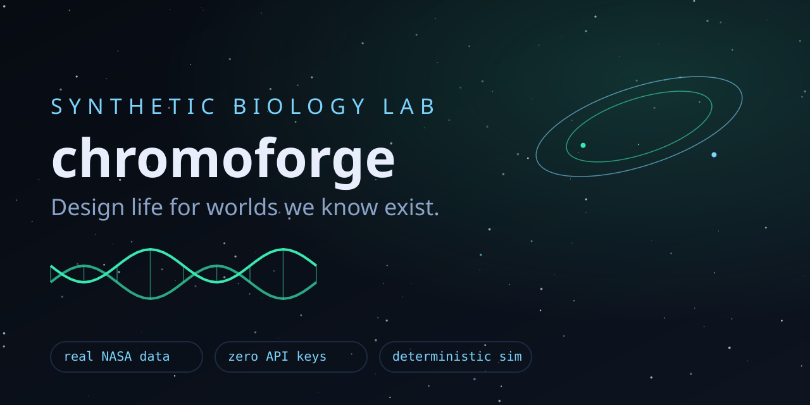
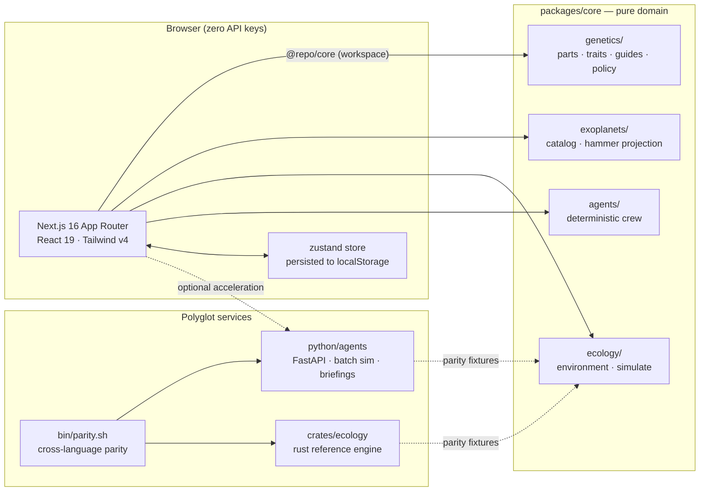

<div align="center">
  
  <h1>chromoforge — design life for worlds we know exist</h1>
  <p>A synthetic-biology foundry: compose a genome, screen it through a published biosafety policy, then release it into a real exoplanet and let the generations decide.</p>
  <p>
    
    
    
    
    
  </p>
  <a href="https://chromoforge.vercel.app"><b>Try the live demo →</b></a> — runs entirely on-device, no API keys
</div>

---

## What is chromoforge?

It is a research workbench for xenobiology. You stack gene cassettes on a bench; the organism's
phenotype derives from what you built, with saturation — a second chaperone helps less than the
first. You design SpCas9 guides scored by GC content and scanned against the organism's actual
assembled sequence for off-targets. A published policy engine screens every construct, and some
combinations are **blocked outright** — that constraint is the feature, not an oversight.

Then you pick a world — a real exoplanet from NASA's archive — and release. Equilibrium
temperature, gravity, radiation and water availability were derived from the catalog's published
parameters; a seeded, deterministic simulation plays out the generations while an agent crew argues
about whether it was a good idea.

## What you can do with it

| I want to… | Go to | What happens |
|---|---|---|
| Build an organism | [/composer](/composer) | Cassettes, copy numbers, live trait derivation |
| Design guides | [/crispr](/crispr) | Ranked protospacers + real off-target counts |
| Pass the gate | [/safety](/safety) | The published policy, every finding, every remediation |
| Get a crew briefing | [/release](/release) | Navigator / Xenobiologist / Ethicist reasoning traces |
| Rename the strain | [/composer](/composer) | Persisted to localStorage, survives reloads |
| Watch it survive | [/theater](/theater) | Population + fitness charts, event log, outcome |
| Browse worlds | [/vault](/vault) | 22 seeded exoplanets, filters, derived environments |
| Find them in the sky | [/atlas](/atlas) | Hammer equal-area map, J2000 coordinates |

## Quickstart

```powershell
git clone https://github.com/aniruddhaadak80/chromoforge.git
cd chromoforge
bun install
bun run dev            # http://localhost:3000 — zero API keys needed
```

```bash
# self-hosted path
docker compose up      # web on :3000
```

Run everything: `bun run typecheck && bun run lint && bun run test && bun run build`

## How it works

1. **Parts → traits.** `packages/core/genetics` derives a nine-axis phenotype from part effects
   with saturating sums; upkeep taxes fitness, so greedy stacking is punished.
2. **Guides.** SpCas9 20-mers with an NGG PAM, scored on GC/homopolymer/self-complementarity,
   ranked after scanning the assembled sequence for ≤2-mismatch near-matches.
3. **The gate.** `BIOSAFETY_POLICY` — six rules, `allow / review / block`, every verdict auditable.
4. **The world.** `deriveEnvironment` turns published catalog parameters into an environment
   profile (equilibrium temperature 288·S^0.25 + documented greenhouse assumption, g = M/R²,
   radiation by star class, water by insolation & radius).
5. **The generations.** `simulate` is a seeded logistic model with selection — same seed, same
   history, always. The Rust crate and Python service implement the identical update order and are
   diffed against TypeScript-generated fixtures (`bun run parity` — shell).

## Architecture



All 14 diagrams live in [`docs/diagrams/`](docs/diagrams/) as `.mmd` sources:

| # | Diagram | Shows |
|---|---|---|
| 01 | [architecture](docs/diagrams/01-architecture.mmd) | monorepo + polyglot wiring |
| 02 | [request flow](docs/diagrams/02-request-flow.mmd) | design → policy gate → guides |
| 03 | [domain model](docs/diagrams/03-domain-model.mmd) | ERD mirroring the bench |
| 04 | [agent lifecycle](docs/diagrams/04-agent-lifecycle.mmd) | crew state machine, the veto |
| 05 | [CI/CD](docs/diagrams/05-ci-cd.mmd) | gates → main → live URL |
| 06 | [user journey](docs/diagrams/06-user-journey.mmd) | first ten minutes |
| 07 | [feature mindmap](docs/diagrams/07-feature-mindmap.mmd) | the product at a glance |
| 08 | [branching](docs/diagrams/08-branching.mmd) | trunk-based + release tags |
| 09 | [roadmap](docs/diagrams/09-roadmap.mmd) | gantt to v0.2.0+ |
| 10 | [domain classes](docs/diagrams/10-domain-classes.mmd) | core abstractions |
| 11 | [tradeoffs](docs/diagrams/11-metrics-quadrant.mmd) | effort vs verifiability |
| 12 | [infrastructure](docs/diagrams/12-infrastructure.mmd) | Vercel, Docker, alternates |
| 13 | [simulation loop](docs/diagrams/13-simulation-loop.mmd) | one generation, step by step |
| 14 | [sky projection](docs/diagrams/14-sky-projection.mmd) | RA/Dec → Hammer pin |

## The scale engine

This repo measures itself instead of bragging:

```powershell
bun scripts/loc-count.mjs            # per-extension report + code vs total lines
bun scripts/loc-count.mjs --min-lines 100000   # fails if under the floor (CI gate)
```

## Documentation map

| Doc | What's inside |
|---|---|
| [docs/guides/quickstart.md](docs/guides/quickstart.md) | install → first organism in five minutes |
| [docs/guides/the-science.md](docs/guides/the-science.md) | the physics, stated honestly |
| [docs/guides/deploying.md](docs/guides/deploying.md) | Vercel / Docker / Fly / Render paths |
| [docs/guides/data-provenance.md](docs/guides/data-provenance.md) | where every number comes from |
| [docs/adr/](docs/adr/) | why the parity engine, why no API keys, why Hammer, why SQLite-default |
| [python/agents/README.md](python/agents/README.md) | the Python service + parity harness |
| [crates/ecology/README.md](crates/ecology/README.md) | the Rust reference engine |
| [docs/runbooks/](docs/runbooks/) | deploy rollback, release process |

## Contributing

Conventional Commits, one logical change per commit, `bun run lint` clean, tests with every
feature. Blocked constructs are blocked — policy changes go through an ADR, not a PR edit.
See [CONTRIBUTING.md](CONTRIBUTING.md) and the `good first issue` queue.

## License

MIT © [aniruddhaadak80](https://github.com/aniruddhaadak80). Built with Next.js, Tailwind v4,
Rust, Python — and a deep suspicion of effortless answers.
